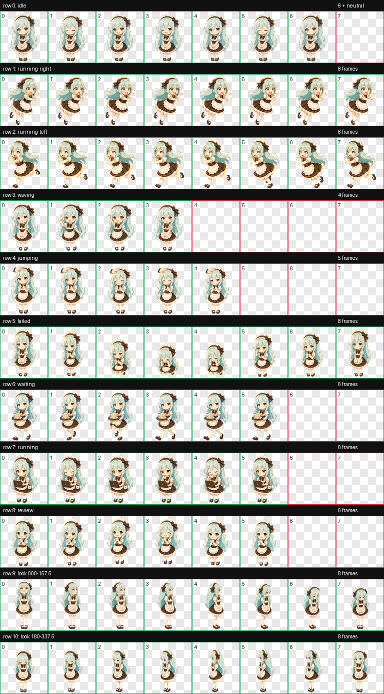

# Minty

Minty is a custom animated pet for the Codex desktop app: a gentle mint-haired chibi maid who works hard, serves coffee, and celebrates completed tasks.



## Install

### Windows

```powershell
irm https://raw.githubusercontent.com/cafeshop-ai/minty/main/install.ps1 | iex
```

### macOS / Linux

```sh
curl -fsSL https://raw.githubusercontent.com/cafeshop-ai/minty/main/install.sh | sh
```

The installer downloads `pet.json` and `spritesheet.webp`, verifies their SHA-256 checksums, and installs them to `~/.codex/pets/minty`. You can [review the Windows installer](install.ps1) or [review the macOS/Linux installer](install.sh) before running it.

Then open **Settings > Pets**, refresh the pet list, and select **Minty**. If the previous sprites remain cached, fully quit Codex and restart it.

### Manual install

Copy `pet.json` and `spritesheet.webp` from this repository into `~/.codex/pets/minty`.

## Sprite Contract

- Codex pet sprite version: `2`
- Atlas: `1536 x 2288` WebP with transparency
- Grid: `8 x 11`
- Cell size: `192 x 208`
- Standard animations: idle, drag right, drag left, waving, jumping, failed, waiting, running, review
- Look directions: 16 clockwise poses

The directional drag animations use eight stable-size frames with a panicked, two-arm struggling pose. The running state retains the coffee interaction.

## Preview

| State | Animation |
| --- | --- |
| Idle |  |
| Drag right |  |
| Drag left |  |
| Running |  |
| Waiting |  |
| Review |  |

All state previews are available in [`previews/`](previews/). Validation and visual QA artifacts are stored in [`qa/`](qa/).
